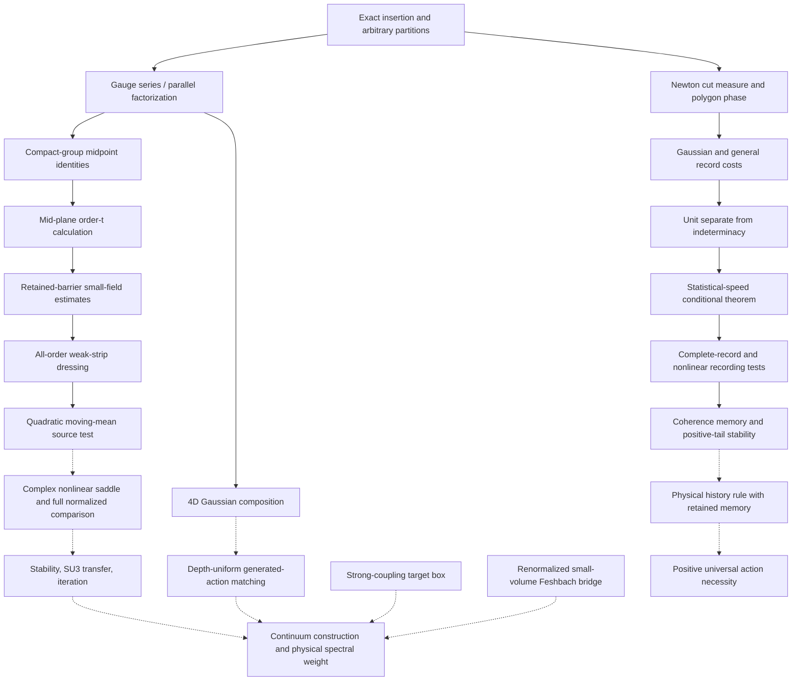

# Current research dependency graph

Navigation map, begun 2026-10-01; Newton paths updated 2026-10-28.
[STATE](STATE.md) selects work; this map does
not change that queue. [The catalog](../notes/index.md) covers every note.
Solid arrows below indicate recommended reading order; the accompanying
text identifies actual mathematical inputs and required corrections.
Dashed arrows mark proposed extensions or supporting transfers, not established
inputs to a completed continuum construction.

## Gauge: the next calculation

Read in this order:

1. [Refinement composition](../notes/refinement-composition-and-limit.md),
   exact insertion identities and the summable-error criterion.
2. [Series/parallel refinement](../notes/series-parallel-gauge-refinement.md),
   Prop. 1: directional halving isolates the interacting mid-plane integral.
3. [SU(2) midpoint](../notes/su2-midpoint-exact.md) and, when changing group
   or cut fraction, [centre-sensitive cuts](../notes/sun-midpoint-centre.md).
   Exact character traces do not supply all matrix entries or volume control.
4. [Order-t mid-plane calculation](../notes/su2-midplane-order-t.md),
   including torus holonomy and the normalized remainder obligation.
5. [Small-field notebook](../notes/su2-midplane-small-field.md), §§24–25
   for targets (112), (113), (116), then §§33–37 for the actual current inputs.

Durable inputs: uniform convexity and joint bad-set rarity, decaying response
kernels with contacts accounted for, an undifferentiated barrier, and a
convergent weak-recoupling gas. Section 35 supplies all-order connected
bad-component control **in its weak strip**. Section 36 constructs exact
dressed activities satisfying (112). Section 37 supplies a fixed source
radius and the subtracted log-barrier bound (177) in a centered quadratic
model. It is a test of part of (113), not the complete nonlinear integral.

The next mathematical step is complex centered nonlinear control with
decaying dependence of the moving saddle on boundary sources. Dependencies
are the fixed-barrier contour/source accounting of §37 and the locality and
connected-support reserves of §§33–36. Abandon a proposed estimate if it
differentiates the barrier, charges moving-mean amplification to every good
connector, assumes contact cancellation, or loses volume-uniform constants.
Physical recoupling, target-covering paths, curvature conversion, group
integral comparison, perturbed-action stability and iteration remain later
obligations. Check group constants before transferring SU(2) results to SU(3).

Keep these constraints within reach:
[local/global Agmon](../notes/agmon-global-not-local.md),
[blocking criterion](../notes/blocking-criterion-monotone.md),
[flow versus coarse graining](../notes/flow-conjugation-truncation.md),
[explicit weak-side thresholds](../notes/small-field-step-decay-and-threshold.md),
and [failed crossover bridges](../notes/reasons-to-stop-as-research.md).
The [obstruction map](obstructions.md) gives the scope of each failure.

## Gauge: four-dimensional matching and the spectral exit

For atlas cell 4 read [Gaussian blocking](../notes/gaussian-blocking-coupling.md)
→ [parallel logarithm](../notes/four-dimensional-parallel-log.md)
→ [4D composition](../notes/four-dimensional-composition.md), especially
its (14) and §7. Exact Gaussian Schur composition and finite one-step
subtractions are inputs; depth-uniform nonlinear contraction and remainder
control remain open. A formal one-loop coefficient is not iteration.

For a physical gap exit read
[lattice obligations](../notes/mass-gap-obligations-lattice.md), with the
[scaling-region correction](../notes/mass-gap-openings.md), then
[strong-coupling target](../notes/strong-coupling-target-box.md) and
[UV halving/IR confinement](../notes/uv-halving-ir-confinement.md).
Strong-coupling volume uniformity is durable. Reaching that box with controlled
generated interactions from a weak-coupling scaling trajectory is open.
T2′ at every bare coupling is stronger than the continuum argument needs.
Construction, nontriviality, volume uniformity, physical time and surviving
gauge-invariant spectral weight must each be supplied.

For STATE's supporting small-volume bridge read
[Feshbach reduction](../notes/weak-coupling-feshbach-reduction.md)
→ [torus valley](../notes/torus-valley-potential.md), together with the
[UV Schur correction](../notes/schur-error-ultraviolet.md).
H3 is the effective zero-mode valley-gap estimate. The full transfer also
needs H1's nonzero-mode separation and a renormalized/fibered H2 Schur bound;
the bare-vacuum error is not uniform as the cutoff is removed. Spectral moment or trial-state upper
bounds do not replace a positive lower bound.
The displayed cutoff torus calculation uses SU(2); applying this supporting
bridge to the main SU(3) goal also requires the corresponding group-dependent
operator estimates.

## Newton: recent dependency paths

The [recent synthesis](../notes/newton-dimock-balaban-guide.md#recent-newton-synthesis)
states the results and their limitations. The paths below identify the
proofs and countertests needed for a particular question; arrows indicate
reading order, not a proof that one physical premise follows from another.

| Question | Proof path | Scope to keep |
| --- | --- | --- |
| How does refinement construct classical motion? | [Time blocking](../notes/balaban-newton-time-blocking.md) → [ODE lesson](../notes/balaban-ode-lesson.md) → [non-Lipschitz time scales](../notes/newton-continuity-time-scales.md) | Endpoint and initial-value problems differ; unbounded slope alone does not imply nonuniqueness |
| What quantum construction is available? | [Quartic $0+1$ theory](../notes/constructive-qft-one-time.md) → [packet construction](../notes/quantum-blocks-construct-newton.md) → [groupoid states](../notes/groupoid-quantum-newton-states.md) → [Lipschitz lift](../notes/lipschitz-certificate-quantum-lift.md) | Positive action and the relevant operator toolkit are supplied; the universal lifting conjecture is open |
| How could the groupoid scale and $\hbar$ be related by RG? | [Rivero 1997, toy RG triangle](https://arxiv.org/pdf/dg-ga/9710026) → [Rivero 1998, two regulators](https://arxiv.org/pdf/quant-ph/9803035) → [control-map test](../notes/rivero-1998-conjecture-central-forces.md) → [groupoid states and blocking](../notes/groupoid-quantum-newton-states.md) | The reference slice and controlled phase parameter are chosen. Construct the normalized control/blocking map and distinguish it from geometric zoom before claiming a physical running or selected $\hbar$ |
| Can a merger or continuity select a floor? | [Cusp preparation floor](../notes/newton-cusp-preparation-floor.md) → [canonical central limit](../notes/central-limit-canonical-gaussian-sector.md) → [history and continuity](../notes/cusp-history-records-continuity.md) | The reversible point-compatibility clause may be vacuous; the later one-time continuity theorem uses actual Gaussian transport and additional copy closure. Neither identifies the floor with $\hbar/2$ |
| What do classical completions and records allow? | [History space and fine records](../notes/cusp-history-records-continuity.md) → [Gaussian meter and nonlinear shear](../notes/gaussian-meter-entropy-floor.md); compare [finite receiver memory](../notes/three-body-cut-memory.md) | History states retain future selection; the finite receiver does not realize cusp branching. The meter uses a diverging-aperture family; the shear only excludes the stated Gaussian-mixture repair |
| Do refinement and quantization determine each other? | [Existence conjecture](../notes/classical-quantum-existence-conjecture.md) → [verification and ordering](../notes/lean-verification-quantum-newton.md) | Fixed-action product convergence, joint-limit ray distance and factor ordering differ; Lean targets are not compiled proofs |
| Does a response ceiling select action? | [Nonlinear cell](../notes/newton-nonlinear-time-cell.md) → [branch-response theorem](../notes/newton-branch-response-action.md) | The weight and uniform ceiling are supplied; classical branch memory and thermal response are countercontrols |

## Newton: earlier recording and memory mechanisms

These paths complement the recent cusp and meter tests:

1. [Fifth postulate](../notes/principia-fifth-postulate.md) →
   [Planck paper](../notes/planck-gap-paper.md): joint determinacy,
   Newton's observable and resource-scoped record/disturbance bounds.
   The Gaussian floor uses non-adaptive independent marks and
   preparation-invariant tests; general instruments have their own
   body, apparatus and comparison-state resources.
2. [Unit and indeterminacy](../notes/necessity-unit-and-indeterminacy.md)
   → [indeterminacy routes](../notes/newton-indeterminacy-routes.md) →
   [recording notebook](../notes/sed-closure-under-recording.md),
   §§8.11–8.23: distinguish a radiation unit, statistical-speed premise,
   full controller records, nonlinear feedback and phase-memory tests.
   Terminal-conjugate recovery and energy exchange remain obligations.
3. [Score-constrained ensembles](../notes/score-constrained-ensemble.md):
   the canonical field action is restricted rather than an invariant
   Newtonian reduction. Its forward completion and branch-dependent copy
   protocol have explicit state/controller assumptions; composition closure
   alone selects no positive coefficient. Nonlinear recording generates
   modes outside the finite family and retains unread recoil energy.

Supporting proofs: [cut measure](../notes/cut-measure-newton.md),
[recoil](../notes/record-costs-recoil.md),
[disturbance](../notes/record-costs-disturbance.md), and
[path length](../notes/record-distance-path-length.md). The
[Leibniz continuity](../notes/leibniz-continuity-records.md) equivalence
uses an optimized invariant Gaussian family, not every fixed protocol;
[stochastic composition](../notes/stochastic-route-velocitas-ultima.md)
does not force its common coefficient to be nonzero; and
[SED calibration](../notes/sed-zeta-radiation-link.md) retains disputed
Planck-spectrum and resonant-variable premises. Earlier countertests and
their exact limits are in [obstructions](obstructions.md).

## Orientation and supporting branches

The principal proof inputs can be read separately from the diagram's routing:

| Established input | Obligation it supplies |
| --- | --- |
| Exact series pushforward and compact-group midpoint identities | Defines the interacting mid-plane comparison; does not bound its normalized remainder |
| Convex reference, undifferentiated barrier, rarity and local connector majorants | Hypotheses for the weak-strip connected and dressed estimates (116)/(112) |
| Exact dressed gas and local affine moving means | Quadratic subtracted source bound (177), a limited test of (113) |
| Gaussian block Schur maps and generated one-step vertices | Formulation of the open depth-uniform subtracted matching estimate (14) |
| Dirichlet action/cut hats and invariant Gaussian mark constraints | Finite-grid distinguishability supremum; independent quantum instrument bounds use their own comparison-state hypotheses |
| Gaussian covariance/statistical-speed premise | Conditional classical disturbance theorem; neither a radiation unit nor prior covariance alone supplies complete-record closure |
| Compressed zero-mode gap, complementary-sector bound and relative Schur estimate | Conditional spectral gap transfer; the required physical bounds and SU(3) estimates remain open |

[Three continuum limits](../notes/three-continuum-limits.md) keeps the pion
comparison as a symmetry/spectral benchmark rather than a third construction
programme. [Halving atlas](../notes/halving-atlas.md) locates open cells;
[refinement results](../notes/refinement-results.md) is a compact theorem
entry point, with later notebook sections needed for the current frontier.
Historical proof architecture in `../newtonlean` is source/formalization
context, not a Lean-build dependency of these modern calculations.
